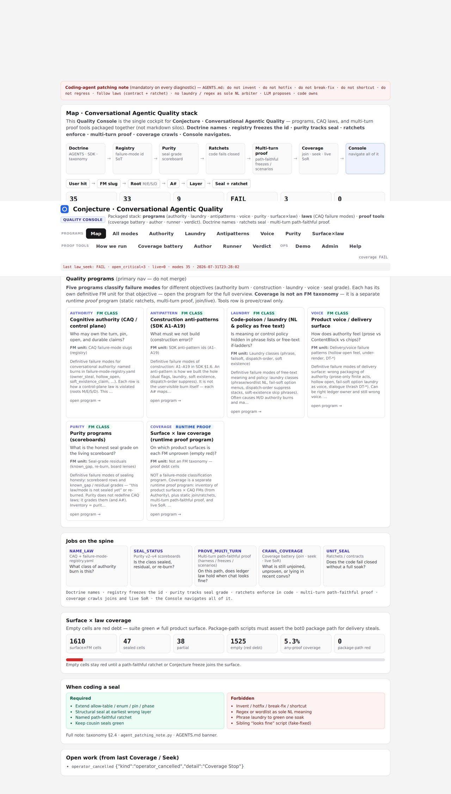
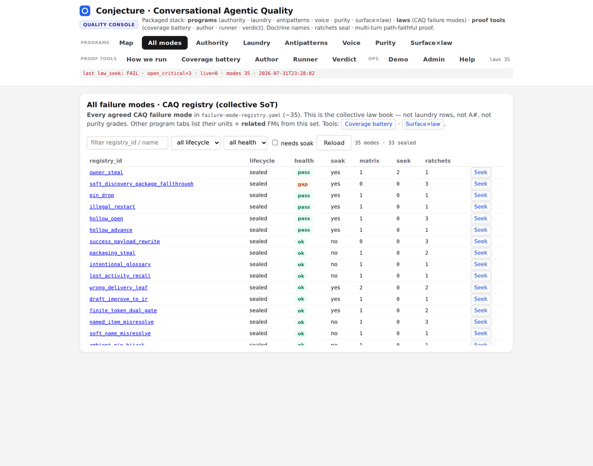
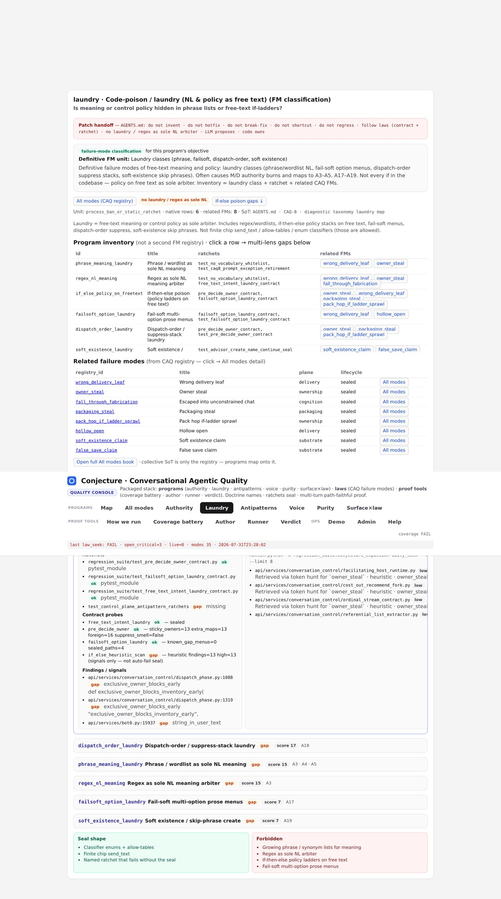
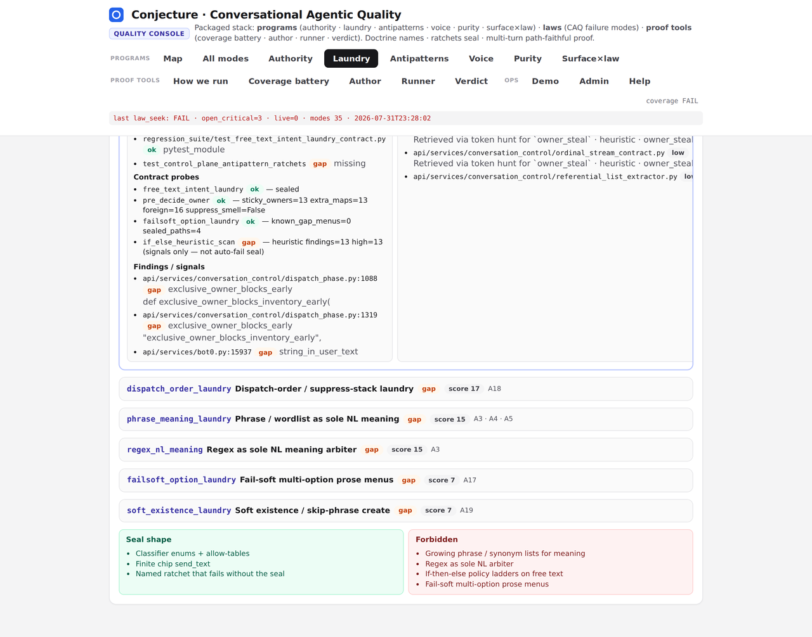
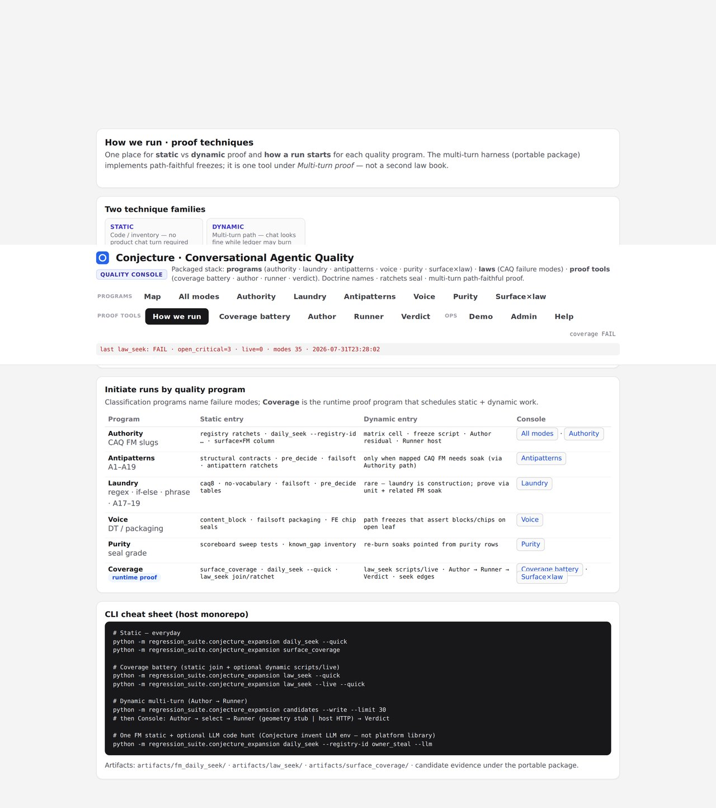
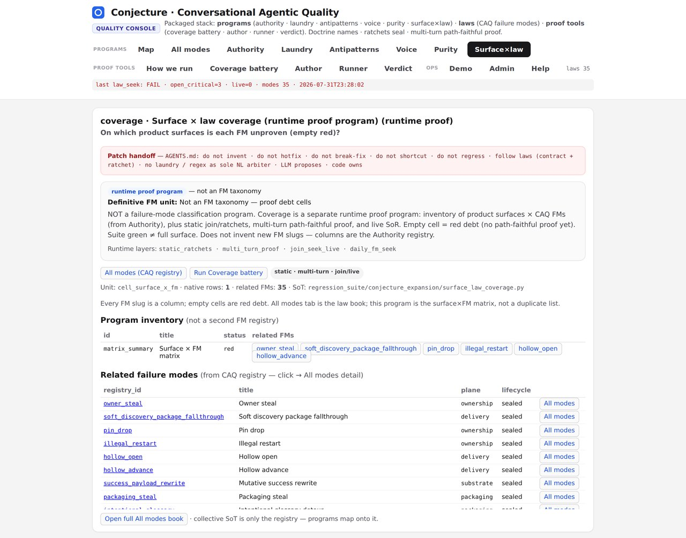
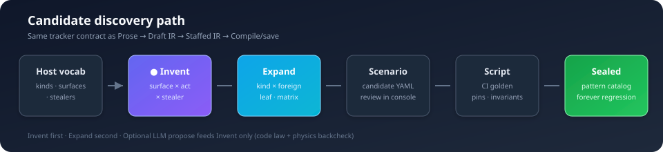

# Conjecture Behaviour Runner

**Catch state-law breaks that still look fine in chat.**

Applies to agentic / LLM products with **durable workflows, real records, and real
handoffs**—claims, tickets, cases, multi-step ops. Free-form Q&A often does not need
this. **LLM proposes · policy validates · code commits** (shorthand: **code enforces** /
**code owns**).

```bash
conjecture path-faithful --prove-bugs   # harness: PASS + planted FAILs
conjecture ui --port 8765               # Quality Console → http://127.0.0.1:8765
```

---

## Sibling of the Control Plane SDK (adopt + prove)

This package is the **proof and quality face** of the same stack as
[**Conversation Control Plane**](https://github.com/walidnegm/conversation-control-plane)
(the **ownership ledger**). They are deliberately split — value-added **together**.

| | **Control Plane SDK** | **This package (Conjecture)** |
|--|----------------------|-------------------------------|
| **Face** | Wire multi-turn **authority** into your host | Catch when chat **looks fine** and **state law is wrong** |
| **Delivers** | Ledger · `decide_turn` · sole writer · multi-turn stream · A1–A19 · cognitive seat | Mode registry · freezes · planted FAIL · **Quality Console** |
| **Answers** | *Who owns the turn, and how do we enforce it?* | *Did we name the law, seal it, and prove it multi-turn?* |

```text
  SDK (ledger + decide)          Conjecture (this package)
  who owns · what is admissible  →  prove that under pinned cognition
  hydrate SoR · adjudicate shape →  registry + freezes + Quality Console
              ── together: adopt the plane + prove the plane ──
```

**SDK seat (cognitive pipeline)** — full tables in the
[CCP README](https://github.com/walidnegm/conversation-control-plane#contract-at-a-glance) /
[SDK §0.0.2](https://github.com/walidnegm/conversation-control-plane/blob/main/docs/conversation-control-plane-sdk.md#authority-adjudication-pipeline-sdk-seat):

| Essay layer | SDK implements | App fills |
|-------------|----------------|-----------|
| **0 Hydration** | Ledger / KindSpec / pins = View SoR | Brief, `allowed_operations`, surface map |
| **1 Semantic** | Closed enums into the plane (not free-text authority) | Classifier *values*, schemas |
| **2 Adjudication** | `decide_turn`, sole writer, exclusive owner, A18 shape | Leaves / EXTRA rows |
| **3 Policy** | Gates, stickiness, foreign deny as tables + lifecycle | Continuum edges, family inventories |
| **4 Execute** | `TaskTransition` only | LangGraph / tools / workers |
| **5 Delivery** | Finite grammar when armed; open-leaf arming | Product voice, chips, continuum pin |

> **SDK** = who owns the turn + admissible transitions + durable ownership SoR.  
> **App** = ops / kinds / surfaces / continuum **values** + product voice.  
> **Conjecture** = assert owner · pin · open-leaf · continuum laws **after Act**, and
> navigate seals in the **Quality Console**.

We are not inventing exclusive owner / pin / yield rules — we **assert them after every
turn** under pinned cognition (and join the same mode ids the SDK anti-patterns / CAQ
map describe). The console does not invent laws either — it **joins** registry ·
ratchets · seek · multi-turn proof so operators and coding agents stop hunting silos.

---

## Two faces of this package

| Face | What it is |
|------|------------|
| **Enforcement harness** | Multi-turn scripts · Observation · invariants · planted-bug CI |
| **Quality Console** | Local **Conversational Agentic Quality** cockpit — programs, CAQ laws, multi-lens gaps, coverage battery, Author → Runner → Verdict |

What authority regression must provide:

- shared multi-turn script shape  
- portable post-turn Observation (owner · active record)  
- fixed labels so enforcement CI is deterministic  
- separate router vs enforcement evaluation  
- healthy-PASS / planted-FAIL discipline  
- named taxonomy of authority failures (`registry.yaml`)  
- discoverability + trajectory invention for edge paths  
- **one place to navigate** doctrine · seals · proof debt (**Quality Console**)  

**Conceptual home:** [**CAQ-FM**](docs/conversational-authority-quality.md) ·
[MATURITY](docs/MATURITY.md) · sibling [**Control Plane**](https://github.com/walidnegm/conversation-control-plane).

**Working taxonomy** (not FMEA): **failure mode slug** = unique registry `id` (class) →
many **incidents** / **candidate scenarios** → **sealed pattern** → **execution evidence**.
Console **All modes** is the law book; program tabs map units onto related FMs (not a
second registry). Author list rows are **scenarios**, not modes.

| Doc | What it is |
|-----|------------|
| [**CAQ-FM**](docs/conversational-authority-quality.md) | Problem + doctrine + taxonomy + loop |
| [**MATURITY**](docs/MATURITY.md) | Stage, battery size, console readiness |
| [**Mode catalog**](incidents/CATALOG.md) | Mode **slugs** (runnable / seed_pending / host_only) |
| [**Registry**](incidents/registry.yaml) | Machine SoT (`id` ↔ `portable_seed`) |
| [**Land playbook**](incidents/README.md) | Classify → capture → patterns/ |
| [**Control Plane SDK**](https://github.com/walidnegm/conversation-control-plane) | Ownership ledger · decide · A1–A19 · hydrate…adjudicate seat |
| **Quality Console** (below) | Programs · multi-lens boards · How we run · screenshots |

**Owners and kinds are yours, not Conjecture’s.** The package does not ship a fixed
catalog of agents or task types. Whatever **type** your ledger defines—
`cost_out`, `invoice_intake`, `claim_review`, `onboarding`, a Temporal activity name,
a LangGraph node id—is what you assert as `exclusive_owner` / `active_kind`. The
same for pins: `workflow_id`, `claim_id`, `invoice_id`, … — host vocabulary projected
into Observation. Demos use **`cost_out` + `workflow_id` only as a concrete
stand-in** (Conversation Control Plane dogfood). Swap the strings; invariant **shape**
stays the same.

**Parameterized templates** (shareable shapes, not product goldens):  
`sole_continue_script(...)` · `reorient_keeps_owner_script(...)` · docs in
[`templates/README.md`](templates/README.md). Example:
`python examples/parameterized_templates.py`.  
CCP host law (reorient ≠ COMPLETE, every result names a transition):
[Host transition discipline](https://github.com/walidnegm/conversation-control-plane/blob/main/docs/host-transition-discipline.md).

CI needs a **fixed classification** (pin or freeze), not a live model roll every
run—so the same golden fails for the same state break on every PR. That is deliberate:
this package does **not** prove the classifier was right. Pair it with separate
classifier tests for cognition drift; use Conjecture for “given these labels, did code
still seal the ledger?”

The ledger can live anywhere (session DB, LangGraph, Temporal, Vercel AI session, …).
If you can project **your** owner/kind/pins after Act, you can import a Driver and get
a **verdict**.

MIT · **0.1.6** · [Bot0.ai](https://bot0.ai)

---

## What this package checks

**Not** “did steps run in the right order?” (ordinal / unit tests).  
**Not** “did the bot write a good sentence?” (LLM eval).

**Yes:** after each user message, do the **deterministic ledger + handoff rules** still hold —
the coded rule-set that says who owns the turn, what is pinned, and when ownership may
yield — even when an LLM *proposes* something that would steal or hijack if code did not
enforce?

| Check | Meaning (host-defined values) |
|-------|---------|
| **Who owns this turn?** | Your ledger’s exclusive owner / kind string vs front door / idle |
| **What is locked?** | Your pin map (whatever ids the host freezes for this task) |
| **Mid-flight / handoff law** | No illegal restart, no silent pin drop; handoff only when *your* rules allow |

**Demo shape only** (mini-app vocabulary — not the only kind Conjecture knows):

```text
# Host example vocabulary: kind=cost_out, pin key=workflow_id
# (could just as well be claim_review + claim_id, invoice_intake + invoice_id, …)

User: "start <your mid-flight task> on record R"
User: "change a field mid-flight"     ← reply can still sound fine

Unit / ordinal tests:  ✅ something returned
LLM eval:              ✅ text looks helpful
Conjecture:            ✅ exclusive_owner still equals the kind your ledger started
                       ✅ pin still equals the same record id
                       ❌ FAIL if continue stole to front_door or dropped the pin
```

In the shipped mini-app that kind string is `cost_out` and the pin is `workflow_id=wf_1`
— convenient dogfood, **not** a product enum.

### Who “deserves to go next”?

In a control-plane style app, that is **not** “parse the last chat line for keywords.”
It is roughly:

1. **Ledger state** — what **kind** is mid-flight?  
   (`active_task.kind` / `exclusive_owner` — **any string your rule-set defines**)  
2. **Entity pin** — which record is locked?  
   (**any** pin keys your host freezes: workflow, claim, ticket, …)  
3. **This turn’s classification** (pinned for CI) — `continue` vs `detour` vs `new_task` / `abandon`

If the ledger says kind **K** is active and the turn is **continue**, **K** owns
delivery even if the user text *looks* like a detour (glossary, FAQ, another product
surface). If the turn is **detour** / **abandon**, ownership **yields** per your rules.

Conjecture asserts those rules still held **after** Act for the **expected strings you
wrote in the golden**. Ordinary ordinal tests do not model exclusive owner or pins.

### Where the ledger lives (does not matter)

Conjecture does **not** require a specific product stack for the ledger. The durable
state may live in:

- a custom DB / JSON session blob  
- **LangGraph** / LangChain checkpoint state  
- **Temporal** workflow state  
- **Vercel AI SDK** / other session stores  
- any control plane that projects **owner · pins · outcome** after a turn  

**What matters:** you have a **rule-set** (coded handoff / sole-continue / pin law) and a
**Driver** that runs Act and returns an **Observation** Conjecture can check. Import
your adapter (or HTTP JSON paths), pin the labels, run the script → **verdict**
(PASS/FAIL + which invariant broke). No need to rewrite the ledger into Conjecture’s
types beyond that projection.

> **Honest scope:** this gates **enforcement** given a pin/freeze — not “the classifier
> was wrong.” Test cognition separately; use Conjecture for owner/pin/handoff regression.
> Full doctrine: [CAQ-FM](docs/conversational-authority-quality.md).

---

## Quality Console — Conversational Agentic Quality

**Shipped and first-class.** `conjecture ui` is the packaged **control tower** for
conversational authority quality — not a thin candidate demo viewer.

```bash
conjecture ui --port 8765
# → http://127.0.0.1:8765
```

### What it is (and is not)

| It **is** | It is **not** |
|-----------|----------------|
| One local cockpit for **laws · seals · multi-turn proof debt** | A second ledger or `decide_turn` |
| Join of CAQ registry + purity + freezes + ratchets + surface×law | A god-agent that freestyle-reviews your monorepo |
| Operator + coding-agent navigation after soaks / seal days | A hosted SaaS product runtime |
| Aligned to the **Control Plane SDK** stack (owner · pin · open · continuum · A#) | A replacement for unit ratchets or the SDK itself |

```text
  Doctrine (SDK A1–A19 · CAQ · taxonomy)
              │
              ▼
  failure-mode registry  (this package: incidents/registry.yaml)
              │
      ┌───────┼────────────┬──────────────┐
      ▼       ▼            ▼              ▼
  purity    matrix      unit ratchets   Conjecture scripts
  grades    cells       contracts       freezes / candidates
      │           │            │              │
      └───────────┴──── law_seek / surface ───┘
                        (coverage battery)
                              │
                              ▼
                    Quality Console (this UI)
```

**Join keys (honest):** `registry_id` · ratchet paths · `script_id` · seek artifacts.
Heuristics on laundry boards are **gap signals**; contracts and freezes still own seals.

### Why it exists

We had several true things that felt like parallel products: CAQ registry, purity
scoreboards, Conjecture freezes, law-seek markdown, host ratchets. After a soak or
seal day, nobody had one place that answered:

1. What **laws** apply? (registry / All modes)  
2. Which are **sealed / partial / open**?  
3. Did **multi-turn proof** pass? (Author → Runner → Verdict)  
4. Where is **static / LLM / behaviour** debt (e.g. if-else poison laundry)?  
5. What **ratchet / script / open work** owns the gap?  
6. How does this relate to the **control plane** (owner · pin · continuum · A#)?  

The console **rationalizes that stack** without merging jobs: purity is not freezes;
freezes do not replace allow-table ratchets; seek does not invent laws — it **joins**
named ones (including continuum / open-leaf / soft-existence modes in the portable
registry).

### Capability board (mature surface)

| Capability | Status | Notes |
|------------|--------|--------|
| **Program taxonomy** | Live | Authority · Laundry · Antipatterns (**SDK A#**) · Voice · Purity · Surface×law — **split**, not one pile |
| **All modes** | Live | CAQ registry law book; programs map *related* FMs onto it |
| **Map / Approach home** | Live | Stack ladder, mode counts, open critical, program cards, **agent patching note** |
| **Laundry multi-lens gap board** | Live | **static** · **LLM/vector seek** · **behaviour** — featured: if-then-else poison |
| **How we run** | Live | Static vs dynamic techniques + per-program CLI cheat sheet |
| **Coverage battery** | Live | law_seek / surface coverage / open critical |
| **Surface×law** | Live | Cartesian proof debt; empty cell ≠ inflate grade |
| **Author → Runner → Verdict** | Live | Multi-turn proof spine |
| **Agent patching note** | Live | Do not invent · hotfix · break-fix · laundry |
| **Quality snapshot API** | Live | `/api/quality-snapshot` · host join densifies inventories |
| **Categories / plane chrome** | Live | Plane vs program labels (CAQ plane ≠ purity program) |

**Doctrine (always on the chrome):** LLM proposes · **code owns** · no laundry / regex as
sole NL meaning · seal with **contract + ratchet** · open-leaf arming and continuum pins
when product invites a next act (SDK delivery law).

### Navigation map

| Nav | Kind | What you see |
|-----|------|----------------|
| **Map** | Home | Stack ladder, mode counts, open critical, program cards, patching note |
| **All modes** | Law book | Registry slugs · lifecycle · seek health · ratchets |
| **Authority** | Program | Ownership / pin / open / continuum / save modes |
| **Laundry** | Program | Code-poison classes + multi-lens gap board |
| **Antipatterns** | Program | **SDK A1–A19** + related FMs (direct Control Plane alignment) |
| **Voice** | Program | Product voice / DT patterns + related FMs |
| **Purity** | Program | Scoreboard rows (seal grade — not a second registry) |
| **Surface×law** | Runtime proof | Surface × FM cells; empty = red debt |
| **How we run** | Techniques | Static entry vs dynamic multi-turn · per-program CLI |
| **Coverage battery** | Proof tool | law_seek join · open work · live hits |
| **Author / Runner / Verdict** | Multi-turn | Invent/expand scenarios → run → backlog |

### Screenshots













### Portable vs host-dense

| Surface | What you get |
|---------|----------------|
| **OSS package alone** | Console shell · Help · candidates · path-faithful tools · portable registry / CATALOG |
| **Host monorepo join** | Dense inventories · full laundry multi-lens · surface×law · live seek — **same chrome** |

Screenshots above are from the **host join**; density lights up when snapshot inventories
are present.

**Do not bloat Conjecture** with the host’s full private D1 registry or product continuum
edge tables. Ship **portable modes + proof spine + console** here; ship **ownership SoR**
in the [Control Plane SDK](https://github.com/walidnegm/conversation-control-plane).

---

## 30-second proof (two paths)

### A. In-process mini-app (fastest)

```bash
git clone https://github.com/walidnegm/conjecture-behaviour-runner.git
cd conjecture-behaviour-runner
pip install -e ".[dev]"

conjecture path-faithful --prove-bugs   # PASS + 3 planted FAILs
conjecture ui --port 8765               # Quality Console (see above)
```

### B. External HTTP app (true portability)

The strongest claim: the **system under test does not import Conjecture**.

```text
proofs/external_http_app/   ← independent SUT (no conjecture imports)
        ↓ HTTP only
HttpJsonAdapter + portable golden + verifier
```

```bash
PYTHONPATH=src python proofs/run_external_http_proof.py --prove-bugs
```

That spawns four independent HTTP processes (healthy + `owner_steal` / `drop_pin` /
`illegal_restart`) and proves the same contracts under **pinned cognition** (`LlmMode.STUB`).

---

## Minimal golden

The mini-app’s mid-flight kind is hard-coded to `cost_out` for the proof path.
On **your** host, replace `cost_out` / `workflow_id` with whatever owner and pin
keys your ledger emits in Observation.

```python
from conjecture_behaviour_runner import (
    ConjectureScript, DialogueTurn, InvariantSpec, CognitionPin,
    run_script, LlmMode,
)
from conjecture_behaviour_runner.path_faithful import MiniAppAdapter, MiniChatApp

# Demo vocabulary only — your golden uses YOUR ledger strings:
#   exclusive_owner / active_kind  e.g. "cost_out" | "invoice_intake" | "claim_review"
#   pin keys                       e.g. "workflow_id" | "invoice_id" | "claim_id"
script = ConjectureScript(
    script_id="demo",
    description="continue keeps host owner and pin",
    conversation_id="conv_1",
    turns=[
        DialogueTurn(
            user_text="cost out the onboarding workflow",
            pin=CognitionPin(task_intent="new_task", read_kind="cost_out"),
            invariants=[
                InvariantSpec(kind="exclusive_owner", expected="cost_out"),
                InvariantSpec(kind="pin_present", expected="workflow_id"),
            ],
        ),
        DialogueTurn(
            user_text="make the volume 10k",
            pin=CognitionPin(task_intent="continue"),
            invariants=[
                InvariantSpec(kind="exclusive_owner", expected="cost_out"),
                InvariantSpec(
                    kind="pin_equals",
                    expected={"key": "workflow_id", "value": "wf_1"},
                ),
            ],
        ),
    ],
)
result = run_script(
    script, adapter=MiniAppAdapter(MiniChatApp()), llm_mode=LlmMode.STUB
)
assert result.passed
```

### Wire your own HTTP app

```python
from conjecture_behaviour_runner.contrib.http_json import HttpJsonAdapter

adapter = HttpJsonAdapter(
    endpoint="http://localhost:8000/chat",
    owner_path="debug.owner",
    pins_path="debug.pins",
    outcome_path="debug.outcome",
)
# result = run_script(script, adapter=adapter, llm_mode=LlmMode.STUB)
```

---

## Five concepts (public model)

**Script · Turn · Driver · Observation · Invariant**

Everything else (Scenario, ODD, multi-runner, Verdict) is advanced — [`docs/SPEC.md`](docs/SPEC.md).

**Quality Console** (`conjecture ui`) is the navigation surface for those concepts
plus CAQ programs and gap boards — [section above](#quality-console--conversational-agentic-quality).
It is a local cockpit, not a hosted product runtime and not a god-agent reviewer.

### Candidate discovery (expander · inventor · optional LLM propose)

Autonomously author **candidate Scenarios** from **your** host vocabulary — not a
fixed product catalog. Normative detail: [`docs/SPEC.md` §2.2](docs/SPEC.md).

Same **progress tracker** idea as product authoring
(Prose → Draft IR → Staffed IR → Compile/save) — one ordered ladder, current stage
highlighted, completed stages struck. Reusable contract:
`conjecture_behaviour_runner.pipeline_tracker`.



```text
📍 Discovery path: Host vocab → Invent → Expand → Scenario → Script → Sealed
```

| Stage | What happens |
|-------|----------------|
| **Host vocab** | Your kinds · exclusive surfaces · pre-decide stealers · typed acts |
| **Invent** | Geometry: surface × typed act × stealer (prefer first) |
| **Expand** | Cross-product: kind × foreign leaf · matrix / residual seeds |
| **Scenario** | Candidate YAML (console review — not CI yet) |
| **Script** | Executable golden (pins · invariants · freeze) |
| **Sealed** | Pattern catalog / host ratchet — forever regression |

| Engine | Role |
|--------|------|
| **Inventor** (prefer first) | Code geometry: exclusive surface × typed act × pre-decide stealer |
| **Expander** | kind × foreign leaf; matrix / residual / incident seeds |
| **Propose** (opt-in) | LLM suggests new surfaces/stealers; **code** law + physics backcheck |

```bash
conjecture candidates author --example --out /tmp/cbr_candidates
# Optional invent LLM (no product model hardcode — set your endpoint):
#   CONJECTURE_INVENT_LLM_BASE_URL / _MODEL / _API_KEY
conjecture candidates author --example --invent-llm --out /tmp/cbr_candidates
CONJECTURE_CANDIDATES_DIR=/tmp/cbr_candidates conjecture ui
```

Defaults: **4** LLM proposals and **4** inventive scenarios per author turn
(`CONJECTURE_INVENT_MAX_*`). Prompt is a file, not inline product prompts:
`candidate_author/prompts/geometry_propose.md`. Full env table and vocabulary
fields: [`templates/candidate_author/README.md`](templates/candidate_author/README.md).

---

## Planted-bug table (machinery)

| Run | Result | Break |
|-----|--------|--------|
| Healthy | **PASS** | — |
| Owner steal | **FAIL** | Continue reports `front_door` while task active |
| Drop pin | **FAIL** | Lost `workflow_id` |
| Illegal restart | **FAIL** | Task wiped mid-flight |

---

## Contribute

[CONTRIBUTING.md](CONTRIBUTING.md) — matrix, sized issues, five-minute path.

Help wanted: real host samples (HTTP), LangGraph/Temporal adapters, **incident patterns**.

### Learning loop (bugs → patterns)

When an agent submits the wrong type into the ledger or skips the ledger contract,
and the **SDK is already complete**, that is often a **Conjecture-class** bug.
Classify → Scenario → Script → catalog:

- **Patterns inventory (list + describe):** [`incidents/CATALOG.md`](incidents/CATALOG.md)  
- Playbook: [`incidents/README.md`](incidents/README.md)  
- Template: [`incidents/_template/`](incidents/_template/)  
- Patterns: [`incidents/patterns/`](incidents/patterns/)

### Where to go (docs map)

| Need | Path |
|------|------|
| Hero demo / planted bugs | this README (above) |
| **Failure-class inventory** | [`incidents/CATALOG.md`](incidents/CATALOG.md) |
| How to land a pattern | [`incidents/README.md`](incidents/README.md) |
| Package unit tests | [`tests/`](tests/) — **not** the inventory |
| Demos / E2E scripts | [`examples/`](examples/) |
| Script shapes (any host kind) | [`templates/README.md`](templates/README.md) |
| Candidate discovery (expand + invent) | [`templates/candidate_author/README.md`](templates/candidate_author/README.md) · SPEC §2.2 |
| Normative spec | [`docs/SPEC.md`](docs/SPEC.md) |
| Agent coder files-first | [`AGENTS.md`](AGENTS.md) §7 |

---

## License

MIT · Copyright © Bot0.ai / contributors.
